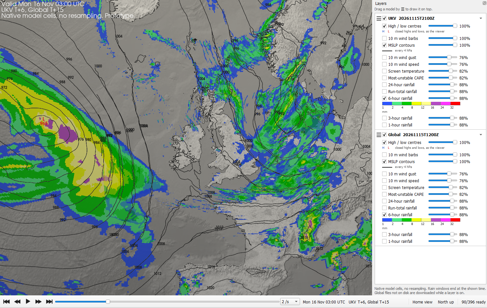

# UKMO NWP Globe

A 3D globe for Met Office model output, for the larger-domain models
where a flat map distorts. The UKMO NWP viewer's layers, for UKV and
the Global 10 km model, on one globe you can spin and zoom, with a layer
panel per model and time controls like the viewer. It does not replace
the flat viewer in the UKMO NWP tools.



## Principle

Each model is drawn on its own native cells, built from the cell bounds
in its NetCDF files (UKV's Lambert equal-area grid is converted to
longitude/latitude with pyproj). Nothing is resampled; a cell's colour
comes from the value in the file, or from a sum of the model's own
files for rainfall windows. Isobars and high/low centres are found on
each model's own grid. Wind barbs are drawn at a subset of cell centres
with those cells' own speed and direction, about 48 km apart.

## Install and run

```
conda env create -f environment.yml
conda run -n ukmo_globe python globe.py
```

## Layers

Every layer exists for both models, with the viewer's bands, colours,
default opacity and default on/off.

| Layer | From | On at start |
|---|---|---|
| High / low centres | MSLP; closed highs (blue H) and lows (red L), the viewer's method | yes |
| 10 m wind barbs | 10 m speed and direction, knots | |
| MSLP contours | black isobars every 4 hPa, labelled | yes |
| 10 m wind gust | km/h, gust warning bands | |
| 10 m wind speed | km/h | |
| Screen temperature | °C | |
| Most-unstable CAPE | J/kg | |
| 24-hour rainfall | sum of the model's files ending at the shown time | |
| Run-total rainfall | sum from the start of the run | |
| 6-hour rainfall | sum | yes |
| 3-hour rainfall | sum | |
| 1-hour rainfall | hourly file | |

Rain windows are summed from the model's own accumulation files: 1-hour
files, and for Global the 3-hour files from T+57 to T+69. A total is
shown only when the files cover the window exactly and none is missing;
it is never made from part of its hours. So 1-hour rain has no Global
data after T+54.

Times run hourly, then 3-hourly in the Global tail to T+69 (UKV to its
own last lead).

## Data

Files are looked for in this project's `data\` folder, then in the UKMO
NWP tools' archive (`--archive`, read only: nothing is written there).
Global files in neither place are downloaded from the Met Office's
public AWS bucket into `data\` while a layer that needs them is
switched on (about 6 MB per field per hour). The newest 2 downloaded
Global runs are kept. UKV files come only from the archive.

## The window

**Layers panel** (right): one group per model, with the run. Drag a
group by ☰ above the other to draw that model on top. Each group has an
on/off tick for the whole model and an arrow to fold it; each layer has
a tick, an opacity slider and (when on) its colour key.

**Time bar** (bottom): first, back, play/pause, forward, last; the time
slider; play speed; the valid time and each model's lead; Home view;
North up; how many layer-hours are ready, and downloads in progress.
Play waits for a time that is not ready yet and stops at the last one.

**Mouse**: drag to turn the globe (north stays up), scroll to zoom,
Shift+drag to pan.

| Key | Action |
|---|---|
| Right / Left | Next / previous time |
| Up / Down, Page Up / Page Down | Six steps on / back |
| Home / End | First / last time |
| Space | Play / pause |
| h | Home view: Ireland, north up |
| n | North up from the current view |

## Options

| Option | Meaning |
|---|---|
| `--archive PATH` | UKMO NWP tools' archive (default `..\ukmo_nwp\data\archive`) |
| `--ukv-run`, `--global-run` | Runs to show, e.g. `20261115T2100Z` (default: newest held). Any published Global run can be given; it is downloaded |
| `--valid TIME` | Starting valid time, e.g. `20261116T0300Z` |
| `--base grey` / `colour` | Background: Natural Earth I shaded relief in grey (default) or in colour |
| `--area atlantic` / `world` | Global area drawn (default `atlantic`: 80°W-50°E, 15-80°N) |
| `--view ireland` / `atlantic` | Starting view |

For testing: `--screenshot FILE` draws off screen and writes a PNG
(with `--show` / `--hide MODEL:LAYER ...`, e.g. `global:cape`,
`--order global ukv`, `--steps N`); `--smoke FILE` opens the window,
saves a picture of it and closes.

## Speed

Layers are prepared only while switched on, by three background
workers, nearest times first, and saved in `cache\` (newest 6 runs
kept), so reopening a run is quick and stepping is near-instant.

## Files

| File | What it holds |
|---|---|
| `globe_core.py` | Layers, rain sums, drawing and background preparation; no window code |
| `globe_data.py` | Finding files and downloading Global ones |
| `globe_pressure.py` | High/low centres, copied from the UKMO NWP tools |
| `globe.py` | The Qt window and the command line |

## Notes

- GeoVista downloads its background picture and coastlines once, into
  `%LOCALAPPDATA%\geovista`; offline use needs these bundled.
- Needs working OpenGL; untested on remote desktops and virtual
  machines.
- Barbs are a fixed spacing; they do not thin or thicken with zoom.
- With both models' isobars on, inside the UKV area you see both sets.
- Not yet: hover values, MOGREPS, other models (ICON, HARMONIE).
