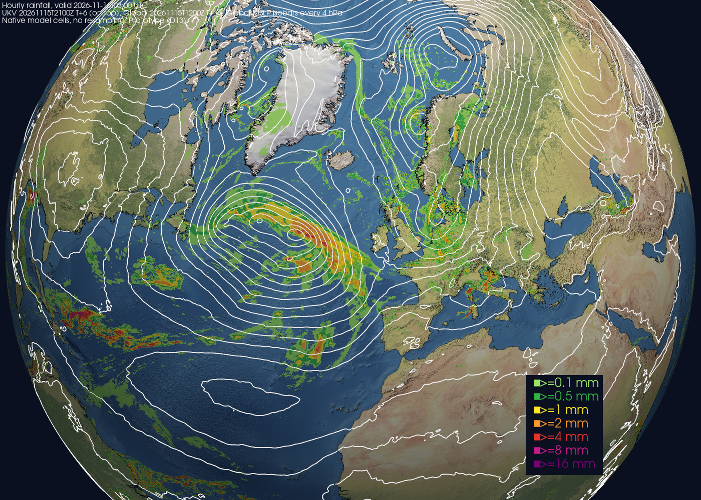

# UKMO NWP Globe

A 3D globe for Met Office model output, for the larger-domain models
where a flat map distorts. Prototype: rainfall from UKV (on top) and the
Global 10 km model, with MSLP isobars from both, on one globe you can spin
and zoom. It does not replace the flat viewer in the UKMO NWP tools.



## Principle

Each model is drawn on its own native cells, built from the cell bounds
in its NetCDF files (UKV's Lambert equal-area grid is converted to
longitude/latitude with pyproj). Nothing is resampled; the value on a
cell is the value in the file. Dry cells (< 0.1 mm) are see-through.

## Install and run

```
conda env create -f environment.yml
conda run -n ukmo_globe python globe.py
```

Opens on Ireland. Drag to turn the globe (north stays up), scroll to
zoom, Shift+drag to pan.

| Key | Action |
|---|---|
| Right / Left | Next / previous hour |
| Up / Down (or Page Up / Page Down) | Six hours on / back |
| h | Home: the Ireland view, north up |
| n | North up from the current view |
| q | Quit |

Buttons at the top left switch each layer on and off: Global rain, UKV
rain, Global MSLP (black isobars) and UKV MSLP (blue isobars, UKV area
only).

| Option | Meaning |
|---|---|
| `--archive PATH` | Download archive of the UKMO NWP tools (default `..\ukmo_nwp\data\archive`) |
| `--ukv-run`, `--global-run` | Runs to show, e.g. `20261115T2100Z` (default: newest in the archive) |
| `--valid TIME` | Starting valid time, e.g. `20261116T0300Z` (default: first hour both models cover) |
| `--base grey` / `colour` | Background: Natural Earth I shaded relief in grey (default) or in colour |
| `--area atlantic` / `world` | Global area drawn (default `atlantic`) |
| `--view ireland` / `atlantic` | Starting view |
| `--hide LAYER ...` | Layers to start switched off, e.g. `--hide "Global MSLP"` |
| `--screenshot FILE` | Write a PNG and exit (`--steps N` steps N hours first) |

Times step through the Global run's hours; UKV is shown for the hours
its run covers.

Global is drawn for the North Atlantic and Europe (80°W-50°E,
15-80°N) by default, a block of its native cells; `--area world` draws
it all.

Once the window is open, two background workers prepare every hour,
nearest hours first, and save them in `cache\` (newest 6 runs kept), so
reopening a run is quick. Measured on a 54-hour run:

| | `atlantic` | `world` |
|---|---|---|
| All hours ready, first opening | 16 s | 37 s |
| All hours ready, reopening | 0.3 s | 0.6 s |
| One step | 0.02 s | 0.06 s |
| Memory for all hours | 0.13 GB | 0.58 GB |
| Disk cache per run | 134 MB | 582 MB |

The grey background is made once and saved in `cache\`. Isobars are
every 4 hPa, contoured on each model's own grid and labelled about every
750 km. UKV MSLP over high ground shows small closed loops, as in the
model field.

The archive layout is `<archive>/<model>/<run>/<parameter>/*.nc`, as
written by the UKMO NWP tools.

## Notes

- GeoVista downloads its background picture and coastlines once, into
  `%LOCALAPPDATA%\geovista`; offline use needs these bundled.
- Needs working OpenGL; untested on remote desktops and virtual
  machines.
- Not yet: hover values, colour bar, time slider, wind, MOGREPS, other
  models (ICON, HARMONIE).
